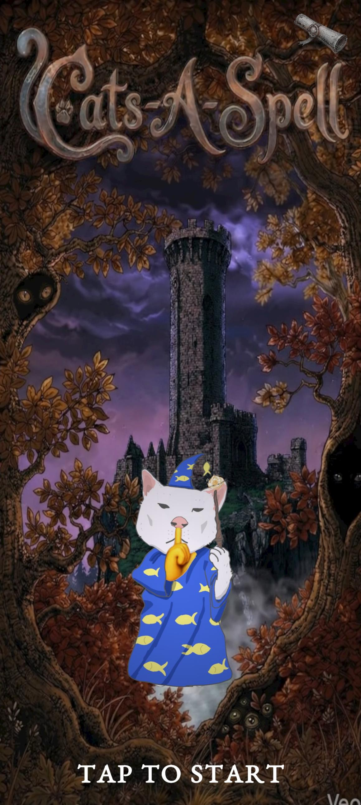
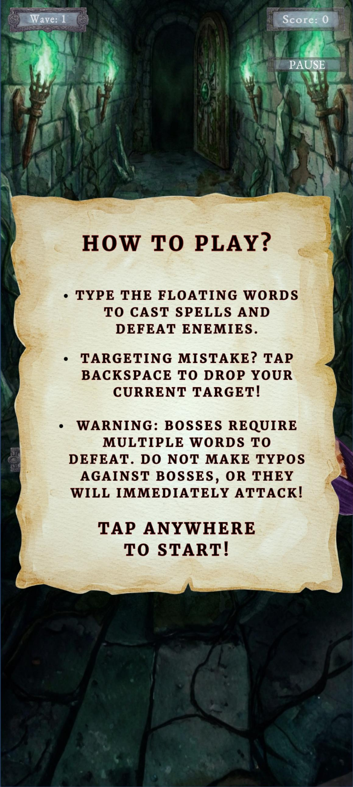
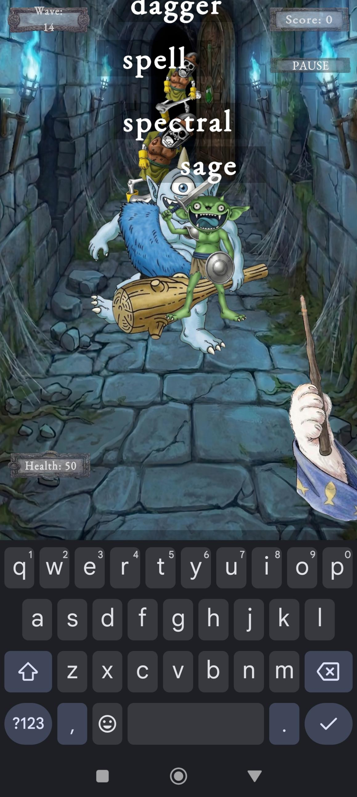
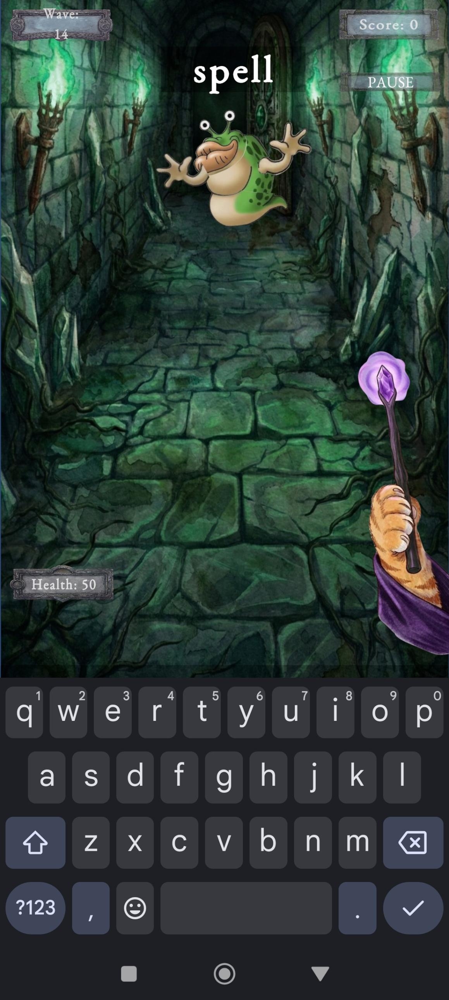
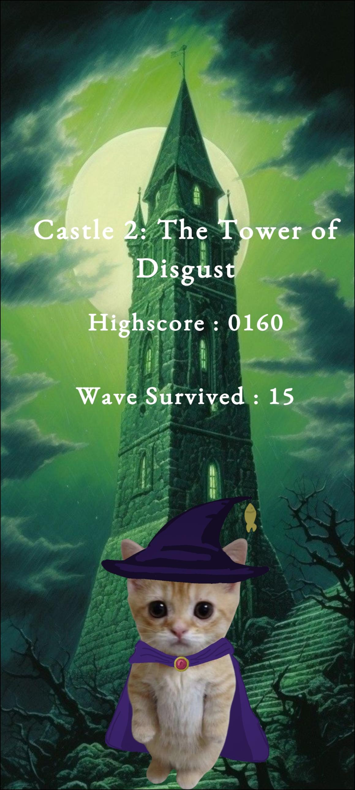

# Cats-A-Spell (Mobile Game)

An Android 2D typing shooter game made in Unity (April 2026). Type the floating words to cast spells and defeat enemies. The waves get harder, and bosses need several words to defeat.

📱 **Download the APK** → [Latest release](https://github.com/3004noemiSS/Cats-A-Spell/releases/latest)
*(Android only. You may need to allow "Install from unknown sources".)*

## My Role
**Lead Developer & Programmer**. My work was:

- Created the game concept for an Android 2D typing shooter with wave-based levels and scaling boss fights
- Designed the playable characters
- Programmed the typing combat, animations, and UI in Unity using C#
- Set up the game audio
- Prepared the sprites in Photopea and Adobe Photoshop

**Tools** → Unity 6, C#, Android, Photopea, Adobe Photoshop, Canva

## Screenshots

  
  
  

  
  

